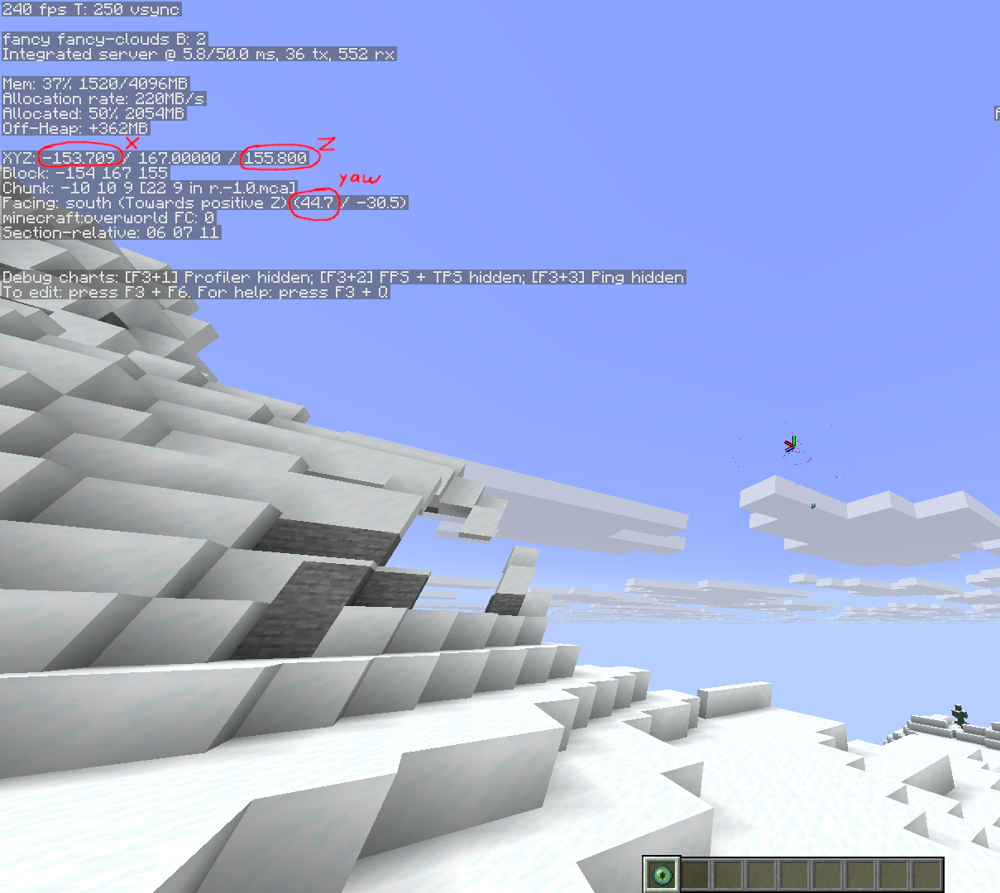
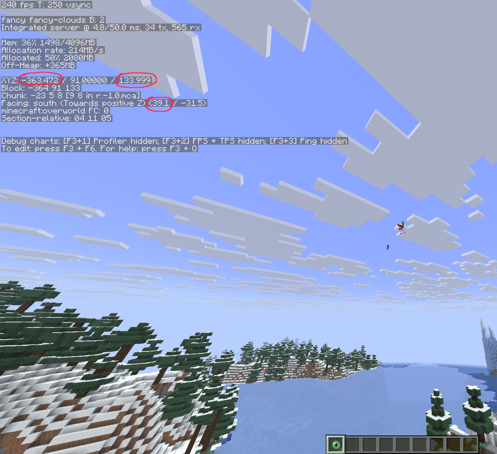
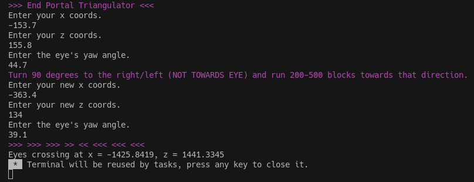
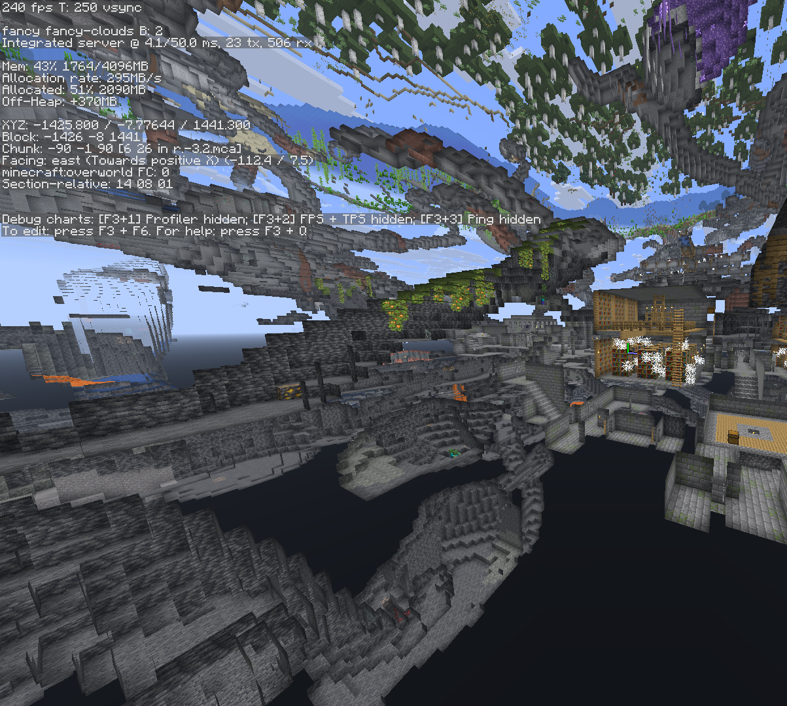

# Minecraft-Stronghold-Triangulator
Easily find the coordinates of the stronghold in <5min with 1-2 ender eyes.

Guide
Step 1.
Press F3
Enter your first X and Z coordinates into the triangulator.
Then use an ender eye and make sure to place your crosshair on where its going.
Now enter the yaw into the triangulator.

Step 2.
Walk 200-500 blocks to the left or right (NOT TOWARDS THE EYE).
Now enter your second X and Z coordinates into the triangulator.
Now throw the ender eye again and enter the yaw into the triangulator.

Step 3.
If you did everything right, it should look similar to this screenshot.

Result.

Note:

Strongholds cannot spawn further than 24.320 blocks away from 0.
The further you go, the more inaccurate it will become.

Also, it is not recommended to go further than 500 blocks away from the first pair of coordinates as this could lead the ender eye to point to a different stronghold. Which would give you useless coordinates.
If you are very close to 0 0 or AT 0 0, you can even walk 100 blocks away from the first pair of coordinates. This was tested in Java 1.21.10 and works.

The further you're away from 0, the further you'll have to move from the first pair of coords.
